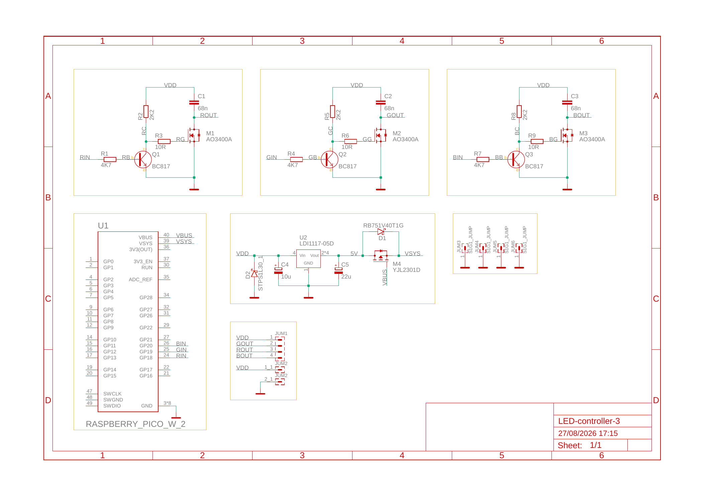
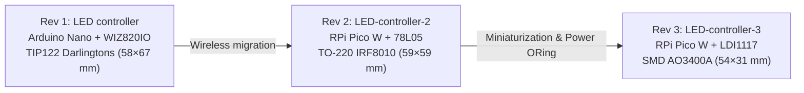

# LED Stripe Controller (v3)

> High-efficiency, ultra-compact 3-channel Wi-Fi and Bluetooth LE RGB LED strip controller powered by the Raspberry Pi Pico W.

**Project Status:** Completed / Production Ready | **Main Technologies:** Autodesk Eagle, Raspberry Pi Pico W (RP2040 + CYW43439), MicroPython, AO3400A SMD MOSFETs, LDI1117 LDO

---

## 1. Overview & Key Features

The **LED Stripe Controller (v3)** is an open-source hardware lighting node engineered for smart home automation. Driven by the dual-core Raspberry Pi Pico W, it enables responsive wireless control of standard 12V or 24V common-anode RGB LED strips over local 2.4 GHz Wi-Fi (MQTT, HTTP REST, Home Assistant) or Bluetooth Low Energy (BLE).

### Key Features
- **3 Independent PWM Channels:** Dedicated low-side switching for Red, Green, and Blue channels (or three independent single-color LED strips).
- **High-Current AO3400A MOSFETs:** Rated at 30V / 5.7A with an ultra-low on-state resistance ($R_{DS(on)} \approx 30\,\text{m}\Omega$), eliminating the need for bulky heatsinks.
- **Active Level Shifter & Gate Drivers:** Onboard BC817 NPN bipolar transistors shift the 3.3V logic levels of the RP2040 up to the strip voltage ($V_{DD}$), guaranteeing fast switching dynamics and minimizing switching losses.
- **Output Snubbers:** High-frequency capacitor snubbers (68 nF) suppress inductive ringing and voltage spikes during PWM edges.
- **Intelligent Dual-Supply Power Path:**
  - Robust 5V LDO (`LDI1117-05D`, 800 mA) provides ample headroom for peak CYW43439 Wi-Fi transmission bursts.
  - Automatic power ORing using a P-channel MOSFET (`YJL2301D`) and Schottky barrier diode (`RB751V40T1G`) allows simultaneous USB debugging/flashing and external $V_{DD}$ power without cross-feeding.
  - Reverse polarity protection diode (`STPS1L30`).
- **Compact Form Factor:** 53.6 mm × 30.7 mm 2-layer PCB designed to match the outline of the Raspberry Pi Pico W.
- **Turnkey Manufacturing Data:** Includes ready-to-order Gerbers, NC drill files, and Pick & Place (PnP) assembly data in a single zip archive.

---

## 2. Architecture & Circuit Design

### Block Diagram

```mermaid
flowchart TD
    subgraph Power["Power Subsystem (12V - 24V DC In)"]
        VIN["DC Power In (JUM2: VDD / GND)"] --> D_REV["Reverse Polarity Diode (STPS1L30)"]
        D_REV --> VDD_BUS["VDD Strip Rail (+12V/+24V)"]
        VDD_BUS --> LDO["LDI1117-05D LDO (+5V, 800mA)"]
        LDO --> OR_SWITCH{"Power ORing Circuit<br/>(YJL2301D P-MOS + Diode)"}
        USB_VBUS["USB VBUS (+5V)"] --> OR_SWITCH
        OR_SWITCH --> VSYS["Pico W VSYS (+5V)"]
        VDD_BUS --> JUM1_VCC["Strip Common Anode (JUM1: +)"]
    end

    subgraph MCU["Processing & Radio"]
        PICO["Raspberry Pi Pico W<br/>(RP2040 @ 133MHz + CYW43439)"]
        PICO -.->|2.4GHz Wi-Fi / BLE| NET["Home Network / Home Assistant"]
    end

    subgraph GateDrivers["Level Shifters & Drivers"]
        PICO -->|GP18 (PWM)| Q1["BC817 Driver"] --> M1["AO3400A (Red Ch)"]
        PICO -->|GP19 (PWM)| Q2["BC817 Driver"] --> M2["AO3400A (Green Ch)"]
        PICO -->|GP20 (PWM)| Q3["BC817 Driver"] --> M3["AO3400A (Blue Ch)"]
    end

    subgraph Load["LED Output"]
        M1 --> ROUT["JUM1 Pin 3 (R-)"]
        M2 --> GOUT["JUM1 Pin 2 (G-)"]
        M3 --> BOUT["JUM1 Pin 4 (B-)"]
        JUM1_VCC --> VOUT["JUM1 Pin 1 (V+)"]
    end
```

### Power ORing Operation
The controller incorporates an ideal diode circuit on the Pico W power rail:
1. When operating on external 12V/24V power alone, the LDI1117 provides regulated 5V to VSYS via P-MOSFET `M4`.
2. When a USB cable is plugged into the Pico W (e.g. for flashing firmware or serial debugging), `VBUS` (+5V) turns off the gate of `M4`, isolating the onboard LDO and preventing back-current into the USB host or regulator.

---

## 3. Hardware Schematic & PCB Design

Below is the complete engineering schematic of the LED Stripe Controller (v3) designed in Autodesk Eagle:



📄 [Open original vector schematic in full resolution (PDF)](LED-controller-3.pdf)

---

## 4. Hardware Specifications

| Parameter | Specification | Notes |
| :--- | :--- | :--- |
| **Input Supply Voltage ($V_{DD}$)** | 9 V – 24 V DC | Standard 12V or 24V LED strip power supply |
| **Output Channels** | 3 independent low-side channels | Red, Green, Blue (common anode) |
| **Max Continuous Current** | 3.5 A per channel (5.7 A peak) | With standard copper heatsinking |
| **Switching Transistors** | AO3400A N-channel MOSFET | $V_{DS} = 30\,\text{V}, R_{DS(on)} \approx 30\,\text{m}\Omega$ (SOT-23) |
| **Gate Driver / Shifter** | 3x BC817 NPN BJT | SOT-23 package, pulled up to $V_{DD}$ with 2.2 kΩ |
| **Snubber Capacitors** | 68 nF / 50 V ceramic (0603) | Suppresses inductive switching transient |
| **Logic Supply Voltage** | 5.0 V DC (up to 800 mA) | LDI1117-05D with 10 µF and 22 µF tantalum capacitors |
| **Microcontroller** | Raspberry Pi Pico W | Dual-core Cortex-M0+ @ 133 MHz, 2MB Flash |
| **Wireless Protocols** | 2.4 GHz 802.11b/g/n Wi-Fi, BLE 5.2 | Driven by Infineon CYW43439 |
| **PCB Dimensions** | 53.59 mm × 30.73 mm | 2 layers, 1.6 mm thickness, 1 oz copper |
| **Connectors** | `JUM1` (4-pin 2.54mm), `JUM2` (2-pin 2.54mm/screw) | Output to strip, DC power input |

---

## 5. Pinout & Connections

### Output Header (`JUM1` - S1G4)
| Pin # | Net Name | Function | Destination |
| :---: | :---: | :--- | :--- |
| **1** | `VDD` | Common Anode (+12V / +24V) | LED Strip (+) wire |
| **2** | `GOUT` | Green Channel (Switched GND) | LED Strip (G) wire |
| **3** | `ROUT` | Red Channel (Switched GND) | LED Strip (R) wire |
| **4** | `BOUT` | Blue Channel (Switched GND) | LED Strip (B) wire |

### Power Input Header (`JUM2` - S2G1)
| Pin # | Net Name | Function |
| :---: | :---: | :--- |
| **1** | `VDD` | Positive DC supply (+12V to +24V DC) |
| **2** | `GND` | Ground return (0V DC) |

### RP2040 GPIO Assignment
| GPIO Pin | Function | Hardware Circuit |
| :---: | :---: | :--- |
| **GP18** | Red PWM | Drives Q1 base via R1 (4.7 kΩ) |
| **GP19** | Green PWM | Drives Q2 base via R4 (4.7 kΩ) |
| **GP20** | Blue PWM | Drives Q3 base via R7 (4.7 kΩ) |

---

## 6. Repository Structure

```text
.
├── .gitignore                      # Ignores Eagle backup files (*.s#*, *.b#*) and OS metadata
├── README.md                       # Comprehensive project documentation
├── LED-controller-3.sch            # Complete schematic (Autodesk Eagle XML format)
├── LED-controller-3.brd            # 2-layer PCB layout (Autodesk Eagle XML format)
├── LED-controller-3.pdf            # Schematic & layout print export
├── LED-controller-3_2025-12-26.zip # Manufacturing CAM package (Gerber & Drill files)
├── docs/
│   └── images/
│       └── schematic.png           # High-resolution schematic preview
└── eagle.epf                       # Autodesk Eagle project configuration
```

### Manufacturing Package Contents (`LED-controller-3_2025-12-26.zip`)
- **Gerber Files:** Top/bottom copper (`copper_top.gbr`, `copper_bottom.gbr`), soldermask, silkscreen, solderpaste, and board outline (`profile.gbr`).
- **Excellon Drill:** `drill_1_16.xln`.
- **Pick & Place (PnP) Assembly:** `PnP_LED-controller-3_front.txt`, `PnP_LED-controller-3_back.txt`.

---

## 7. Firmware & Software Integration

The hardware is compatible with MicroPython, CircuitPython, and C/C++ (Pico SDK).

### Complementary Firmware Repository
Firmware and IoT networking modules for this board are developed in the companion project **[rpi_pico](../../CVUT/projekty/rpi_pico)** (MQTT clients, BLE peripheral advertising, and ambient sensor integrations).

### Quickstart MicroPython Example
The following snippet initializes 20 kHz PWM outputs (above the human audible threshold to eliminate coil whine) and performs a smooth color cycle:

```python
from machine import Pin, PWM
import time
import math

# Initialize PWM channels on GP18, GP19, GP20
pwm_r = PWM(Pin(18))
pwm_g = PWM(Pin(19))
pwm_b = PWM(Pin(20))

# 20 kHz prevents audible acoustic noise
PWM_FREQ = 20000
for pwm in (pwm_r, pwm_g, pwm_b):
    pwm.freq(PWM_FREQ)

def set_rgb(r: float, g: float, b: float):
    """Set RGB levels from 0.0 (off) to 1.0 (full brightness)."""
    # Note: Low-side driver turns ON when gate is HIGH
    pwm_r.duty_u16(int(r * 65535))
    pwm_g.duty_u16(int(g * 65535))
    pwm_b.duty_u16(int(b * 65535))

# Smooth color wheel demo
angle = 0.0
try:
    while True:
        r = (math.sin(angle) + 1.0) / 2.0
        g = (math.sin(angle + 2.094) + 1.0) / 2.0  # +120 deg
        b = (math.sin(angle + 4.188) + 1.0) / 2.0  # +240 deg
        set_rgb(r, g, b)
        angle += 0.05
        time.sleep(0.02)
except KeyboardInterrupt:
    set_rgb(0, 0, 0)
```

---

## 8. Hardware Revision History



1. **[Rev 1 (LED controller)](../LED%20controller/):** Wired Ethernet solution built on Arduino Nano and WIZ820IO (W5500 SPI). Used TO-220 TIP122 Darlingtons with high thermal losses.
2. **[Rev 2 (LED-controller-2)](../LED-controller-2/):** Initial migration to Raspberry Pi Pico W. Introduced discrete MOSFETs (IRF8010) and bipolar gate drivers, but relied on a 100 mA 78L05 regulator and larger THT board dimensions.
3. **Rev 3 (This Repository):** Final SMD miniaturization (53.6 mm × 30.7 mm). Features 800 mA LDI1117 regulator, intelligent USB/DC power ORing, and high-efficiency SOT-23 AO3400A MOSFETs. Production tested and manufacturing ready.
